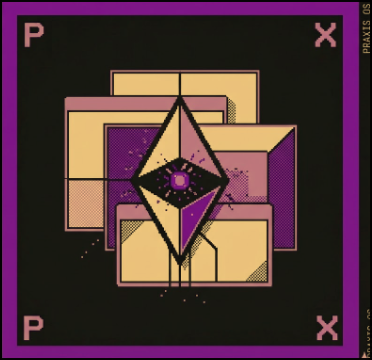
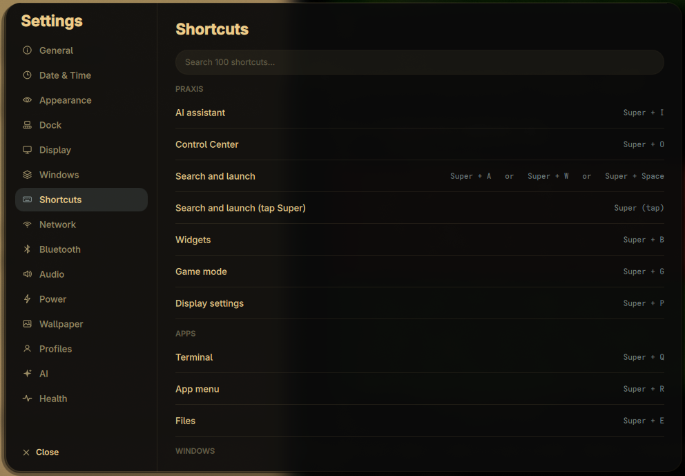
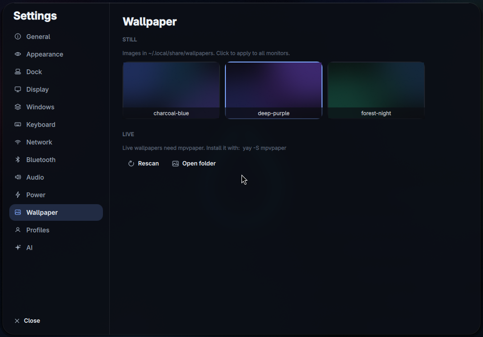
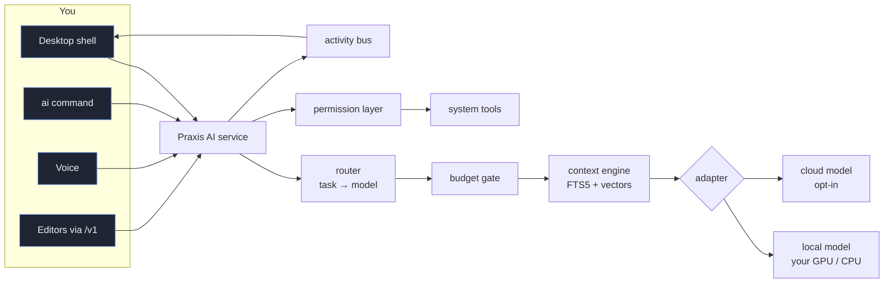

<p align="center"></p>
<h1 align="center">Praxis</h1>
<p align="center"><b><i>Knowledge, put into action.</i></b></p>
<p align="center">
  <b>A Linux desktop with an AI that lives inside it — private, offline-first, and fast on an ordinary laptop.</b><br>
  Boot it from a USB stick, install it next to Windows in a few clicks, then talk to your computer, type with your voice,<br>
  and run your whole day from the keyboard. Nothing leaves your machine unless you decide it should.
</p>

<p align="center">
  <a href="https://github.com/MrMehulkhanna/praxis/actions/workflows/ci.yml"></a>
  
  
  
  
  
  
</p>

<p align="center">
  <a href="https://mrmehulkhanna.github.io/praxis/"><b>🌐 Official Website</b></a> ·
  <a href="#-get-it">Get it</a> ·
  <a href="#-what-you-get">Features</a> ·
  <a href="#%EF%B8%8F-shortcuts">Shortcuts</a> ·
  <a href="#-how-it-works">How it works</a> ·
  <a href="#-develop">Develop</a>
</p>

---

## 🎯 The motto

**Praxis** is the Greek word for turning knowledge into action. That is the whole idea:

> Your computer already knows a lot about you — your files, your notes, your work.
> It should *act* on that knowledge: answer your questions, type what you say, fix itself,
> and get out of your way. Without sending your life to someone else's server.

Most "AI desktops" are a chat window bolted onto an operating system. Praxis is built the other way
round: the AI is a **system service** that every part of the desktop talks to — the top bar, the
launcher, voice, the terminal, your editor. Pick a model once and it is used everywhere.

### What we want to achieve

| | |
|---|---|
| 🔒 **Private by default** | Models run on your own GPU or CPU. Cloud models are opt-in, and a paid one can't even be reached unless you allow it. No telemetry, ever. |
| ⚡ **Fast on real hardware** | Designed on a 16 GB laptop with a 6 GB GPU. Everything adapts to the machine it lands on — GPU drivers, model size, refresh rate, battery. |
| 🧘 **Never in your way** | One keyboard shortcut for everything, gestures that follow your fingers, and a desktop that heals itself instead of asking you to open a terminal. |
| 🤝 **Safe for everyone** | An installer that protects Windows and your files, an AI that can't run a dangerous command without asking, and updates that never ask for a password. |

---

## 🚀 Get it

1. **Download** the ISO from [Releases](https://github.com/MrMehulkhanna/praxis/releases) (≈ 2 GB) — or build it on Arch with `bash iso/build.sh`.
2. **Write it to a USB stick:** `bash iso/flash.sh praxis-*.iso` — refuses anything that isn't a USB disk and verifies the copy afterwards.
3. **Boot it** (UEFI, Secure Boot off). The live desktop starts by itself — try everything before installing.
4. **Click _Install Praxis_ in the dock.** Pick next to Windows, free space, one partition or the whole disk — done.

> 📖 Step-by-step help, partitioning tips and hardware troubleshooting: **[Installation Guide](docs/INSTALLATION.md)**

Already installed? Update to the newest version at any time — **Settings › Update**, or:

```bash
curl -sL https://raw.githubusercontent.com/MrMehulkhanna/praxis/main/iso/airootfs/usr/local/bin/praxis-update | bash
```

---

## ✨ What you get

### 🧠 An AI built into the system — not an app

| | |
|---|---|
| **Ask your computer anything** | `Super+I` opens the AI panel from anywhere. Ask about your system, your files, your code. The agent gathers *real* diagnostics before it answers instead of guessing. |
| **Runs on your own hardware** | Local models through llama.cpp on NVIDIA (CUDA), AMD and Intel (Vulkan) or the CPU. `praxis-models recommend` picks models that fit your GPU's memory; download from Hugging Face with one click. |
| **Voice typing everywhere** | `Super+H`, speak, `Super+H` again — your words are transcribed **locally** with Whisper and typed into whatever has focus: browser, editor, chat, terminal. Or swipe down with four fingers. |
| **Say it, get a command** | `Super+Shift+H` turns what you say into a terminal command. It's typed for you to read — never run behind your back. |
| **Reads the screen** | `Super+Shift+O` copies any text you can see — from images, videos, PDFs, error dialogs. `ai see screenshot.png "what's wrong?"` explains a picture. |
| **Your documents, searchable** | `ai rag add ~/notes` — then ask questions across your own notes and papers. Retrieval happens on your machine. |
| **Remembers the right things** | A context engine picks the most useful past conversation under a strict token budget — answers get better, not slower and more expensive. |
| **Cloud when *you* want it** | OpenAI, Gemini, Groq or OpenRouter keys are optional. Budget modes — **₹0 Zero Cost**, free tiers only, ask-first, or unrestricted — are enforced at a single choke point. |
| **AI that can't hurt you** | Every command the AI proposes is classified *auto / confirm / forbidden*. Only an explicit safe list runs unattended, and every decision is written to an audit log. |
| **AI off in one tap** | Control Center › **AI off** frees the GPU and its memory completely — for games, video calls or battery. |

### 🪟 Window management that feels like magic

| | |
|---|---|
| **Snap with arrows** | `Super+←` / `Super+→` snaps a window to the left or right half, `Super+↑` maximises, `Super+↓` puts it back. Exact to the pixel, around the bar and the dock. |
| **Thirds** | `Super+Alt+1 / 2 / 3` — left, centre or right column. Perfect for wide monitors. |
| **Three layouts, one key** | `Super+Alt+M` cycles **tiles → master + stack → 3 columns** with the main window in the middle. |
| **Two monitors, zero friction** | `Super+Shift+← / →` throws a window to the other screen instantly. |
| **Workspaces your way** | `Super+1…9` to switch. `Super+Shift+1…9` sends a window away and you stay; `Super+Ctrl+1…9` and you go with it. |
| **Gestures that follow your fingers** | Three-finger swipe sideways — the workspaces move 1:1 with your hand. Swipe up for the overview of every workspace, down for the launcher. |
| **Buttery motion** | Spring-based window animations, soft-landing curves on every panel, tuned for 60 and 120 Hz. |
| **Every shortcut, in plain words** | **Settings › Shortcuts** lists all 100+ shortcuts and gestures, grouped and searchable — read live from your session, so it's always right. |

<p align="center"></p>

### 🖥️ A desktop that's beautiful *and* useful

| | |
|---|---|
| **Live top bar** | CPU, memory, GPU memory, network speed and temperatures at a glance; a clock that's always visible and right-clicks to sync. |
| **Launcher & command palette** | Tap `Super` — apps, files, settings and actions in one search box. |
| **Control Center** | Wi-Fi, Bluetooth, audio, brightness, night light, power profile and the three **modes**: |
| &nbsp;&nbsp;🎮 **Game mode** | `Super+G` — performance profile, no notifications, no blur, no animations. |
| &nbsp;&nbsp;🔋 **Battery saver** | Turns itself on when you unplug: 60 Hz, still wallpaper, lighter AI. |
| &nbsp;&nbsp;🤖 **AI on/off** | Free the GPU in one tap. |
| **Widget board** | `Super+B` — a StandBy-style board of glanceable widgets. |
| **Task manager** | `Ctrl+Shift+Esc` — live CPU *and* GPU use per process, and one Stop button for running AI jobs. |
| **Built-in tools** | Clipboard history (`Super+Shift+V`), emoji picker (`Super+.`), colour picker (`Super+Shift+C`), screen recorder (`Super+Shift+R`), quick notes (`Super+N`), screenshots (`Print`). |
| **Wallpapers** | Thirteen original stills and three seamless **live** wallpapers, decoded on the integrated GPU so the big one can sleep. |
| **Settings that do real things** | Wi-Fi scan, Bluetooth pairing, audio routing, displays, dock, power, date & time, AI models, and a **Health** page — all in one window. |

<p align="center"></p>

### 💻 Hardware that just works

| | |
|---|---|
| **Right drivers, automatically** | CPU microcode and GPU drivers are chosen from the PCI IDs — Intel, AMD, NVIDIA, hybrid laptops and older cards included. |
| **Brightness on every laptop** | Many laptops expose two backlight controls and only one works. Praxis finds the one that really drives the screen — keys, slider and idle dimming all use it. OLED panels never go fully black. |
| **Displays without fear** | Change resolution, refresh rate or scale; if you don't press **Keep** within 15 seconds it goes back by itself. Kept settings survive a restart. |
| **Audio follows you** | Plug in headphones or connect Bluetooth earbuds — sound and mic switch over automatically. |
| **No more freezes** | Compressed swap sized to your RAM, thrashing protection, and an out-of-memory guard that stops the AI model first — never your desktop. |
| **Clock agrees with Windows** | Dual-boot time is handled for you; time zone is detected automatically. |

### 🛡️ An installer you can trust with your Windows PC

| | |
|---|---|
| **Next to Windows, with a slider** | Shrinks Windows' drive only after checking it's safe — BitLocker, Fast Startup and disk errors are explained, never risked. A test run comes first and the partition table is backed up. |
| **Or any way you like** | Free space, one partition you pick, or the whole disk. **btrfs with snapshots** (one before every update, bootable from the menu) or ext4. |
| **App bundles** | Office, Developer, Media, Creative, Gaming (with 32-bit drivers), Chat — tick what you want. |
| **Boots straight into Praxis** | Some HP and Acer firmware keeps putting Windows first, so you'd need F9/F12 every time. Praxis puts itself back at the front of the boot order on every start, and keeps a fallback loader the firmware always finds. Windows stays one click away in the boot menu. |
| **Tested like it matters** | Every install type is run for real into disk images — including a fake Windows 11 disk full of files — then booted and checked in a virtual machine. Windows' files must be byte-identical afterwards. |

### 🔄 Updates and self-care

| | |
|---|---|
| **One-click updates** | **Settings › Update** pulls the newest desktop, tools and fixes from GitHub and applies them for every user on the PC — no password prompts, no restart needed. |
| **Self-healing** | `praxis doctor` checks the whole system; `praxis doctor --fix` applies the fixes that are safe to automate. Also in **Settings › Health**. |
| **Snapshots** | On btrfs, every update is preceded by a snapshot you can boot from the menu if anything goes wrong. |

---

## ⌨️ Shortcuts

The essentials — the full, searchable list is in **Settings › Shortcuts**.

| Everyday | | Windows | | Tools | |
|---|---|---|---|---|---|
| Tap `Super` | Search & launch | `Super+← / →` | Snap left / right | `Super+H` | Voice typing |
| `Super+I` | AI assistant | `Super+↑ / ↓` | Maximise / restore | `Super+Shift+O` | Copy text from screen |
| `Super+O` | Control Center | `Super+Alt+1/2/3` | Thirds | `Super+Shift+V` | Clipboard history |
| `Super+Tab` | All workspaces | `Super+Alt+M` | Next layout | `Super+.` | Emoji |
| `Super+B` | Widgets | `Super+Shift+← / →` | Other monitor | `Super+Shift+C` | Colour picker |
| `Super+Q` | Terminal | `Super+Shift+1…9` | Send to workspace | `Super+Shift+R` | Record screen |
| `Super+L` | Lock | `Super+C` | Close | `Print` | Screenshot |
| `Ctrl+Shift+Esc` | Task manager | `Super+V` | Float / tile | `Super+G` | Game mode |

**Gestures:** 3 fingers ← → switch workspace · 3 fingers ↑ overview · 3 fingers ↓ launcher · 4 fingers ↓ voice typing

---

## 🧰 The `ai` command

```console
$ ai "why is my laptop hot?"          # agent — collects real diagnostics, then answers
$ ai code "add a retry to this fn"    # coding model, with your folder and git context
$ ai see diagram.png "what's wrong?"  # local vision model
$ ai do "set volume to 40%"           # system control, permission-checked
$ ai rag add ~/notes; ai rag q "…"    # ask your own documents
$ praxis doctor --fix                 # health check + safe fixes
$ praxis mode game on                 # Game mode (also: ai off, saver on)
```

Editors and other tools can use the same models through an OpenAI-compatible endpoint (`/v1`).

---

## 🏗️ How it works



<details>
<summary><b>Engineering highlights</b> — the parts worth reading</summary>

**Context under a budget** — `src/core/context/engine.py`
Candidates come from SQLite FTS5, scored `0.45·BM25 + 0.25·recency + 0.30·importance`, deduplicated,
and retrieval **stops early** once the budget is met — capped at 50 % of the context window.

**Provider independence** — `src/core/gateway/`, `src/adapters/`
One adapter protocol: a local llama.cpp adapter that sizes GPU offload to free VRAM, and one
OpenAI-compatible adapter serving eight cloud providers from a JSON file.

**Cost safety as structure** — `src/core/gateway/gate.py`
A paid provider is *unreachable* unless the budget mode allows it; the check sits where every request
must pass, before any HTTP request exists.

**Default-deny commands** — `src/core/perms/policy.py`, `voice/`
A command must positively match a safe list to run unattended; read-only commands are demoted the moment
their output is redirected. Voice has its own list. Everything is audited.

**Stopping work for real** — `src/core/activity.py`
Stop races every token read against a cancel event, so it works even mid-prompt, and a client that
disconnects can never leave a job running forever.

**An installer tested without a person** — `iso/airootfs/usr/local/bin/praxis-install-engine`, `iso/test-install.sh`
Both installers only collect answers; one engine does the work from a plan file. Real installs into disk
images are booted in QEMU and checked through the guest agent, and 150+ static checks run on every push.

</details>

<details>
<summary><b>Repository layout</b></summary>

```
src/        AI service (FastAPI): context, gateway, router, permissions, tools, agent, voice, RAG
ai          the command-line client
voice/      push-to-talk pipeline + default-deny voice command list
desktop/    desktop shell (Qt 6 / QML), window manager config, notifications, wallpapers
iso/        live ISO profile, installer, build / flash / publish scripts, system tools
tests/      pytest (backend, voice) + iso_checks.sh
tools/      wallpaper generators, hardware helper, utilities
```

</details>

---

## 🛠️ Develop

```bash
python -m venv .venv && .venv/bin/pip install -r requirements.txt
cp config/aios.env.example config/aios.env && chmod 600 config/aios.env
systemctl --user enable --now aios.service
.venv/bin/python -m pytest tests/ && bash tests/iso_checks.sh
sudo iso/test-install.sh alongside-btrfs wipe-ext4      # real installs into disk images, booted in QEMU
```

`ai doctor` names anything missing. Contributions, bug reports and ideas are welcome — open an issue.

## 🧭 Principles

**Local-first · private · model-agnostic · cost-aware · offline-capable · user-controlled · transparent.**
No hidden automation. No telemetry. Your computer works for you.

## 📜 License & credits

MIT — see [`LICENSE`](LICENSE). Praxis stands on the shoulders of great open-source projects —
Arch Linux, Hyprland, Quickshell, llama.cpp, Whisper, PipeWire and many more — each under its own
license. Praxis is an independent project, not affiliated with any of them.

<p align="center"><sub>Made by <a href="https://github.com/MrMehulkhanna">Mehul Khanna</a> · <i>knowledge, put into action</i></sub></p>
