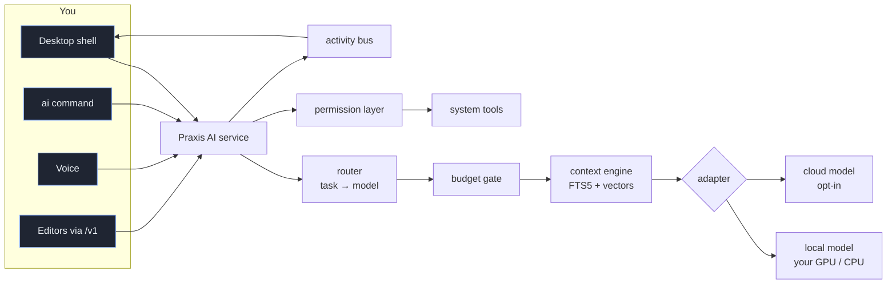

<p align="center"></p>
<h1 align="center">Praxis</h1>
<p align="center">A Linux desktop with an AI living inside it, not bolted on top.</p>

<p align="center">
  <a href="https://github.com/MrMehulkhanna/praxis/actions/workflows/ci.yml"></a>
</p>

<p align="center">
  <a href="https://mrmehulkhanna.github.io/praxis/"><b>Website</b></a> ·
  <a href="#install">Install</a> ·
  <a href="#what-it-does">What it does</a> ·
  <a href="#how-it-is-built">How it is built</a> ·
  <a href="#what-does-not-work-yet">Limits</a>
</p>

---

Praxis is an Arch-based desktop where the AI is a **system service** rather than an
application. The top bar, the launcher, voice typing, the terminal and your editor
all talk to the same service, so you pick a model once and it is used everywhere.
It runs on your own GPU or CPU. Nothing leaves the machine unless you say so.

> Your computer already knows a great deal about you — your files, your notes, your
> work. It should *act* on that: answer questions, type what you say, fix itself, and
> get out of the way. Without sending your life to someone else's server.

*Praxis* is Greek for turning knowledge into action. That is the whole idea.

<p align="center"></p>

## Honest status

One person has written all of this, starting in October 2026. It is young. I use it
as my only operating system, which is the only reason I would ask anyone else to
try it — every bug reaches me first.

What that means in practice:

- **Developed and daily-driven on one laptop**, an ASUS Vivobook with Intel + NVIDIA
  graphics and a Samsung OLED panel. Other hardware is handled by detection rather
  than by testing, so treat it as best-effort and please report what breaks.
- **The installer is the exception.** It is tested without a human on every push:
  real installs into disk images, including one containing a synthetic Windows 11
  partition, booted in QEMU and checked through the guest agent. Windows' files must
  come back byte-identical or the build fails.
- **Back up anything you cannot lose** before installing, as with any young OS.

## Install

1. **Download** the ISO from [Releases](https://github.com/MrMehulkhanna/praxis/releases) (~2 GB),
   or build it on Arch with `bash iso/build.sh`.
2. **Write it to a USB stick** — `bash iso/flash.sh praxis-*.iso`. It refuses anything
   that is not a USB disk and verifies the copy afterwards.
3. **Boot it** with UEFI and Secure Boot off. The live desktop comes up on its own, so
   you can try everything before committing to anything.
4. **Click _Install Praxis_** in the dock. Alongside Windows, into free space, over one
   partition, or the whole disk.

Partitioning and hardware notes live in the [installation guide](docs/INSTALLATION.md).

Already installed? **Settings › Update**, which shows progress in a window and tells
you when a restart is genuinely needed.

## What it does

### The AI

`Super+I` opens the assistant anywhere. Ask about your system and the agent gathers
real diagnostics before answering rather than guessing from the question.

`Super+H` starts voice typing: speak, press it again, and the words are transcribed
locally with Whisper into whatever has focus — browser, editor, terminal.
`Super+Shift+O` copies any text you can see on screen, including from images and
video. `ai rag add ~/notes` makes your own documents searchable, locally.

Models run through llama.cpp on NVIDIA, AMD, Intel or the CPU; `praxis-models
recommend` picks ones that fit your GPU. Cloud providers are optional and off by
default — a paid one is unreachable until you both add a key and raise the budget
mode, checked at a single point every request passes through.

Every command the AI proposes is classified **auto**, **confirm** or **forbidden**.
Only an explicit safe list runs unattended, and each decision is written to an audit
log. Control Center › **AI off** frees the GPU entirely in one tap.

### The desktop

Hyprland and a Quickshell front end: a live top bar, a launcher on tap-`Super`, a
Control Center, a widget board, and a task manager that shows GPU use per process.

Windows snap with the arrow keys, into halves, thirds and three layouts. Three-finger
swipes move workspaces 1:1 with your hand. Every shortcut is listed, grouped and
searchable in **Settings › Shortcuts**, read live from the running session so the list
cannot drift from reality.

Thirteen original wallpapers and three seamless live ones, decoded on the integrated
GPU so the discrete card can idle.

### Sharing a screen with another machine

`Super+Shift+S`. Two Praxis machines on a network can work as one desk. **Extend**
asks Hyprland for a headless output and sends it over, so the second laptop becomes a
real third display with its own workspaces — not a mirror. Sound travels in the same
stream as the picture, so the two cannot drift apart.

A viewer needs a six-digit code shown on the host. It is a TLS pre-shared key, not a
password checked after connecting: without it the handshake fails and the stream is
never reached, and the session key is derived from it, so everything after is
encrypted. There is nothing to copy between machines.

Over a local network the picture arrives roughly **15–40 ms** late. That is fine for a
browser or a terminal on the far screen. It is not good enough for games.

### Hardware

Drivers and microcode are chosen from PCI IDs at install time. Laptops often expose
two backlight devices where only one drives the panel, so Praxis finds the real one
and uses it for the keys, the slider and idle dimming alike. Displays can be changed
freely: a mode you do not confirm within 15 seconds reverts itself.

Compressed zstd swap sized to your RAM, kernel PSI thrashing protection, and an
out-of-memory guard that unloads the AI model before anything else — the compositor
is the last thing to go, not the first.

## Shortcuts

The essentials. The full searchable list is in **Settings › Shortcuts**.

| Everyday | | Windows | | Tools | |
|---|---|---|---|---|---|
| Tap `Super` | Search & launch | `Super+← / →` | Snap left / right | `Super+H` | Voice typing |
| `Super+I` | AI assistant | `Super+↑ / ↓` | Maximise / restore | `Super+Shift+O` | Copy text from screen |
| `Super+O` | Control Center | `Super+Alt+1/2/3` | Thirds | `Super+Shift+V` | Clipboard history |
| `Super+Tab` | All workspaces | `Super+Alt+M` | Next layout | `Super+Shift+S` | Share screen |
| `Super+B` | Widgets | `Super+Shift+← / →` | Other monitor | `Super+Shift+C` | Colour picker |
| `Super+Q` | Terminal | `Super+Shift+1…9` | Send to workspace | `Super+Shift+R` | Record screen |
| `Super+L` | Lock | `Super+Z` | Minimise | `Print` | Screenshot |
| `Ctrl+Shift+Esc` | Task manager | `Super+C` | Close | `Super+G` | Game mode |

**Gestures** — three fingers sideways switches workspace, up shows the overview, down
opens the launcher; four fingers down starts voice typing.

## The `ai` command

```console
$ ai "why is my laptop hot?"          # agent: collects real diagnostics, then answers
$ ai code "add a retry to this fn"    # coding model, with your folder and git context
$ ai see diagram.png "what's wrong?"  # local vision model
$ ai do "set volume to 40%"           # system control, permission-checked
$ ai rag add ~/notes; ai rag q "…"    # ask your own documents
$ praxis doctor --fix                 # health check, then the fixes that are safe
```

Editors and other tools reach the same models through an OpenAI-compatible endpoint
at `/v1`.

## How it is built



Roughly 3,800 lines of Python, 8,000 of QML, and 49 system tools, with 145 unit tests
and 163 checks over the ISO tree.

<details>
<summary><b>The parts worth reading</b></summary>

**Context under a budget** — `src/core/context/engine.py`
Candidates come from SQLite FTS5, scored `0.45·BM25 + 0.25·recency + 0.30·importance`,
deduplicated, and retrieval **stops early** once the budget is met, capped at half the
context window. The aim is useful context per token, not maximum context.

**Provider independence** — `src/core/gateway/`, `src/adapters/`
One adapter protocol. A local llama.cpp adapter sizes GPU offload to free VRAM; one
OpenAI-compatible adapter serves eight cloud providers from a JSON file. Removing a
provider needs no code change.

**Cost safety as structure** — `src/core/gateway/gate.py`
A paid provider is *unreachable* unless the budget mode allows it. The check sits
where every request must pass, before an HTTP request exists — not a flag a caller
can forget.

**Default-deny commands** — `src/core/perms/policy.py`
A command must positively match a safe list to run unattended, and a read-only command
is demoted the moment its output is redirected. The regression suite pins the bypasses
that were found the hard way, and equally pins the ordinary commands that must keep
working, so a fix cannot over-correct into uselessness.

**Authenticated screen sharing** — `iso/airootfs/usr/local/bin/praxis-share-gate`
The stream binds to loopback; a gate owns the port other machines can reach. The
six-digit code is a TLS-PSK, so a wrong code fails the handshake rather than being
rejected after connecting, and the session is encrypted by the same secret.

**An installer tested without a person** — `iso/test-install.sh`
Both installers only collect answers; one engine does the work from a plan file. Real
installs into disk images are booted in QEMU and verified through the guest agent.

</details>

<details>
<summary><b>Repository layout</b></summary>

```
src/        AI service (FastAPI): context, gateway, router, permissions, tools, agent, voice, RAG
ai          the command-line client
voice/      push-to-talk pipeline and the default-deny voice command list
desktop/    Quickshell desktop (Qt 6 / QML), Hyprland config, notifications, wallpapers
iso/        live ISO profile, installer, build / flash / publish scripts, system tools
tests/      pytest (backend, voice) and iso_checks.sh
tools/      wallpaper generators, hardware helper, utilities
```

</details>

## What does not work yet

- **Input sharing between machines is unverified.** The server starts and listens, but
  the keyboard and mouse actually crossing to a second machine has never been tested
  on two machines at once.
- **Screen sharing has no discovery.** You type an address and a code; there is no
  "find machines nearby".
- **Hardware beyond this one laptop is best-effort.** Brightness in particular varies
  wildly between vendors and has known problems on some HP Omen models.
- **No secure boot support.** You must disable it.
- **The ISO is ~2 GB** because models and drivers are bundled for offline install.

If you hit something, an issue with `praxis doctor` output attached is the fastest
path to a fix.

## Develop

```bash
python -m venv .venv && .venv/bin/pip install -r requirements.txt
cp config/aios.env.example config/aios.env && chmod 600 config/aios.env
systemctl --user enable --now aios.service
.venv/bin/python -m pytest tests/ && bash tests/iso_checks.sh
sudo iso/test-install.sh alongside-btrfs wipe-ext4   # real installs into disk images, booted in QEMU
```

`praxis doctor` names anything missing. Issues and pull requests are welcome.

## License

MIT — see [`LICENSE`](LICENSE). Praxis stands on Arch Linux, Hyprland, Quickshell,
llama.cpp, Whisper and PipeWire among others, each under its own license, and is not
affiliated with any of them.

<p align="center"><sub>Made by <a href="https://github.com/MrMehulkhanna">Mehul Khanna</a> · <i>knowledge, put into action</i></sub></p>
