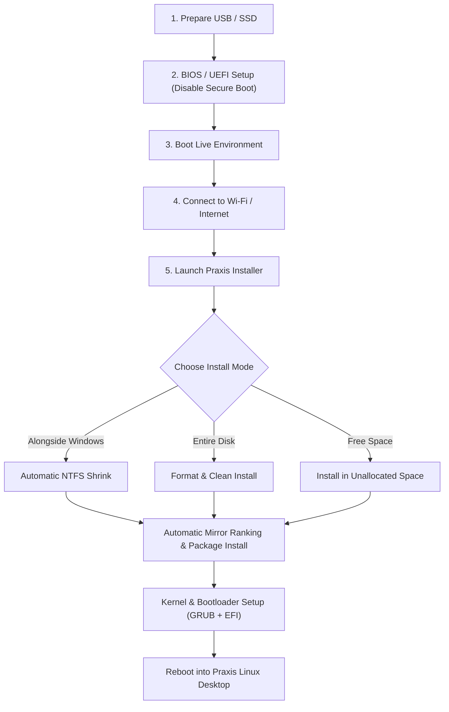

# 🚀 Praxis Linux — Complete Installation Guide

Welcome to the official installation guide for **Praxis Linux**. This guide walks you through every stage of the installation process — from preparing your installation media to booting into your new desktop.

---



---

## Table of Contents
1. [System Requirements](#system-requirements)
2. [Step 1: Download & Flash the Media](#step-1-download--flash-the-media)
3. [Step 2: Motherboard & BIOS Setup](#step-2-motherboard--bios-setup)
4. [Step 3: Boot into the Live Session](#step-3-boot-into-the-live-session)
5. [Step 4: Connect to the Internet](#step-4-connect-to-the-internet)
6. [Step 5: Run the Installer](#step-5-run-the-installer)
7. [Step 6: Partitioning & Disk Options](#step-6-partitioning--disk-options)
8. [Step 7: Installation Progress](#step-7-installation-progress)
9. [Step 8: First Boot & Desktop Tour](#step-8-first-boot--desktop-tour)
10. [Troubleshooting & Hardware Quirks](#troubleshooting--hardware-quirks)

---

## System Requirements

| Component | Minimum | Recommended for Local AI |
| :--- | :--- | :--- |
| **Processor** | 64-bit x86_64 CPU (Intel / AMD) | 4+ Cores (Intel 10th Gen+ or AMD Ryzen) |
| **RAM** | 4 GB | 16 GB+ |
| **Storage** | 30 GB free space | 64 GB+ High-speed NVMe SSD |
| **Graphics** | Intel HD / AMD Radeon / NVIDIA | NVIDIA RTX GPU with 6+ GB VRAM |
| **Firmware** | UEFI 64-bit | UEFI 64-bit with Secure Boot disabled |

---

## Step 1: Download & Flash the Media

### 1. Download the ISO
Download the latest `praxis-*.iso` from the [GitHub Releases](https://github.com/MrMehulkhanna/praxis/releases) page.

### 2. Flash to a USB Drive or External SSD
You can write the ISO using the built-in flasher or any standard tool:

#### On Linux (Recommended):
```bash
bash iso/flash.sh praxis-2026.10.19-x86_64.iso /dev/sdX
```
*(The script verifies checksums byte-for-byte upon completion).*

#### On Windows:
- Use **Rufus**: Select the ISO → Choose **DD mode** (or standard ISO mode) → Write.
- Or use **BalenaEtcher**.

---

## Step 2: Motherboard & BIOS Setup

1. Insert your bootable USB/SSD into the target PC.
2. Power on the PC and immediately tap your brand's BIOS key:
   - **HP**: `Esc` or `F10`
   - **Dell**: `F2`
   - **Lenovo**: `F2` or Novo button
   - **ASUS / Acer / MSI**: `Del` or `F2`
3. Configure the following settings:
   - **Secure Boot**: `Disabled` *(Required for standard Linux EFI bootloaders)*.
   - **Boot Mode**: `UEFI` *(Legacy/CSM should be disabled)*.
   - **SATA Mode**: `AHCI` *(If applicable, not RAID/Intel RST)*.
4. Save and Exit (`F10`).

---

## Step 3: Boot into the Live Session

Tap your PC's **Boot Menu Key** during startup:
- **HP**: `F9`
- **Dell / Lenovo / Acer**: `F12`
- **ASUS**: `F8` or `Esc`

Select your USB/SSD drive in **UEFI mode**.

The live environment will boot straight into the **Praxis desktop** powered by **Hyprland** and **Quickshell**.

> [!NOTE]
> **Live Session Credentials** (if prompted):  
> - Username: `praxis`  
> - Password: `praxis`  
> *(Passwordless `sudo` is enabled in the live environment)*.

---

## Step 4: Connect to the Internet

An internet connection is required during installation to fetch the latest system packages and rank the fastest mirrors.

1. **Via Top-Bar**: Click the Network / Wi-Fi icon in the top right corner and select your network.
2. **Via Terminal**: Press `Super + Enter` and type:
   ```bash
   nmtui
   ```
   Select **"Activate a connection"**, choose your Wi-Fi network, and enter your password.

---

## Step 5: Run the Installer

You can launch the installer in two ways:
1. **Graphical Installer**: Click the **"Install Praxis Linux"** icon in the dock or run:
   ```bash
   praxis-installer
   ```
2. **Terminal Text Installer** (for lightweight or headless installs):
   ```bash
   praxis-install
   ```

---

## Step 6: Partitioning & Disk Options

The installer automatically detects existing operating systems and disks:

### Option A: Install Alongside Windows (Dual Boot)
- Automatically checks NTFS partition health and BitLocker status.
- Adjust the slider to choose how much space to give Praxis (minimum 30 GiB).
- Praxis safely shrinks Windows, creates Linux partitions in the freed space, and preserves all your Windows files!
- Configures hardware clock synchronization so Windows and Linux never disagree on the time.

### Option B: Wipe Entire Disk (Clean Install)
- Erases the target disk completely.
- Creates a clean GPT layout: `512M EFI System Partition` (`/boot/efi`) and `Root Partition` (`/`).

### Option C: Use Existing Free Space or Custom Partition
- Installs into pre-existing unallocated space on your drive without touching any other partitions.

### File System Choice:
- **Btrfs (Recommended)**: Enables subvolume layout (`@`, `@home`, `@log`, `@snapshots`), automatic Zstandard compression, and automatic `snapper` snapshots before and after every system update!
- **Ext4**: Traditional rock-solid Linux filesystem.

---

## Step 7: Installation Progress

The installer runs fully unattended once choices are confirmed:
1. **0% – 12%**: Disk preparation, partition creation, and filesystem formatting.
2. **12% – 45%**: Automatic fastest-mirror ranking via `reflector` and downloading system packages.
3. **45% – 75%**: Unpacking and installing packages into the target root.
4. **75% – 85%**: Generating `fstab`, user creation, locale, and hardware driver configuration (Intel / AMD / NVIDIA).
5. **85% – 95%**: Building initramfs and installing **UEFI GRUB** with automatic NVRAM boot priority.
6. **100%**: Complete! Click restart or reboot your machine.

---

## Step 8: First Boot & Desktop Tour

Remove the USB/SSD and turn on your PC. It will boot directly into **Praxis Linux**:

### 🌟 Desktop Highlights & Built-in Features:

* **Top Bar**:
  - Live system monitoring: CPU %, RAM, GPU VRAM, network speeds, temperatures.
  - Left-click Clock: Opens Calendar & Notification Center.
  - Right-click Clock: Instant background NTP time & timezone auto-synchronization.
* **Control Center (`Super + O`)**:
  - Quick toggles for Wi-Fi, Bluetooth, Dark Mode, Night Light, and Performance modes.
* **Date & Time Settings**:
  - Open **Settings (`Super + O`) → Date & Time**.
  - One-click **Auto-sync Time** (detects your timezone from network location).
  - **Windows Dual-Boot Clock Fix** button.
* **Voice Typing (`Super + H`)**:
  - Press `Super + H` anywhere, speak naturally, and local Whisper AI types your text directly into any focused window!
* **Command Palette (`Super + Space`)**:
  - Quick launcher for applications, system tools, web searches, and calculations.
* **System Doctor (`praxis-doctor`)**:
  - Run `praxis-doctor` in terminal to run complete automated diagnostics on your system health.
* **Rolling System Updater (`praxis-update`)**:
  - Open Settings → Click **"Update System"** (or run `praxis-update` in terminal).
  - Updates system packages, pulls latest features from GitHub, and hot-reloads desktop with **zero password prompts**!

---

## Troubleshooting & Hardware Quirks

### HP Laptops: Setting GRUB Boot Priority
On some HP laptops, Windows Boot Manager may try to override GRUB on the first boot:
1. Power on and immediately tap **F9** to open the Boot Menu.
2. Select **Praxis** (or select **"Boot From EFI File"** → `EFI/Praxis/grubx64.efi`).
3. Once booted into Praxis, run:
   ```bash
   sudo efibootmgr
   sudo cp /boot/efi/EFI/Praxis/grubx64.efi /boot/efi/EFI/BOOT/BOOTX64.EFI
   ```
   This permanently sets GRUB as the fallback bootloader.

### Acer Laptops: Trusting the Bootloader
Acer laptops require manual trusting of new UEFI executables:
1. In BIOS (`F2`), set a **Supervisor Password** under the Security tab.
2. Select **"Select an UEFI file as trusted for executing"**.
3. Choose `HDD0` → `EFI` → `Praxis` → `grubx64.efi`.
4. Name it `Praxis`, save (`F10`), and restart.

### Dedicated NVIDIA GPUs:
If booting with a dedicated NVIDIA GPU on a desktop or hybrid laptop, Praxis automatically loads `nvidia-open` or `nouveau`. If launching manually from TTY:
```bash
Hyprland
```
Or with Nvidia environment variables:
```bash
env LIBVA_DRIVER_NAME=nvidia XDG_SESSION_TYPE=wayland GBM_BACKEND=nvidia-drm __GLX_VENDOR_LIBRARY_NAME=nvidia Hyprland
```
